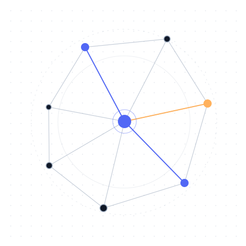

# Teoría de grafos

Arturo Fernández

---

# Objetivo

Comprender los fundamentos de la teoría de grafos, sus formas de representación y sus principales aplicaciones en situaciones de la vida cotidiana.

<ul class="objective-list">
  <li>
    <svg viewBox="0 0 36 36" aria-hidden="true">
      <path d="M8 26 18 9 28 26Z" />
      <circle cx="8" cy="26" r="3" /><circle cx="18" cy="9" r="3" /><circle cx="28" cy="26" r="3" />
    </svg>
    Comprender qué es un grafo.
  </li>
  <li>
    <svg viewBox="0 0 36 36" aria-hidden="true">
      <rect x="5" y="5" width="26" height="26" rx="3" /><path d="M5 14h26M5 22h26M14 5v26M22 5v26" />
    </svg>
    Aprender a interpretar sus representaciones.
  </li>
  <li>
    <svg viewBox="0 0 36 36" aria-hidden="true">
      <path d="M9 27h11a6 6 0 0 0 0-12h-2a5 5 0 0 1 0-10h9" />
      <circle cx="8" cy="27" r="3" /><circle cx="28" cy="5" r="3" />
    </svg>
    Reconocer sus aplicaciones prácticas.
  </li>
</ul>

---

# Relaciones en una red social

<RelationshipTable />

Cada fila indica a quién sigue una persona. Cada columna representa a la persona que recibe esa conexión.

---

# La misma información como grafo

<DirectedGraph />

Los vértices representan a las personas y las aristas dirigidas indican quién sigue a quién.

---
clicks: 6
class: history-slide
---

# Las mentes detrás de la teoría de grafos

De los puentes de Königsberg a las redes modernas.

<HistoryTimeline :step="$clicks" />

---
class: graph-definition-slide
---

# ¿Qué es un grafo?

En Matemáticas y Ciencias de la computación se llama grafo al conjunto de vértices o nodos unidos por aristas o arcos que representan una relación entre los elementos de un conjunto.

$$
G = (V, E)
$$

Llamamos <strong>V</strong> al conjunto de vértices y <strong>E</strong> al conjunto de aristas.

---
class: graph-uses-slide
---

# ¿Dónde se utilizan los grafos?

<dl class="graph-uses">
  

    <dt>Redes sociales</dt>
    <dd>Representar relaciones de amistad y seguimiento entre usuarios.</dd>
  

  

    <dt>Mapas y GPS</dt>
    <dd>Calcular rutas entre distintos lugares.</dd>
  

  

    <dt>Transporte público</dt>
    <dd>Representar conexiones entre estaciones y recorridos.</dd>
  

  

    <dt>Internet</dt>
    <dd>Estudiar las conexiones entre computadores y servidores.</dd>
  

  

    <dt>Biología y medicina</dt>
    <dd>Analizar interacciones entre proteínas y redes de propagación de enfermedades.</dd>
  

  

    <dt>Logística</dt>
    <dd>Optimizar rutas de entrega y distribución de productos.</dd>
  

</dl>

---
class: lesson-slide
---

# Elementos de un grafo

  <LessonGraph name="basics" :focus="$clicks === 0 ? ['A'] : $clicks === 2 ? ['A','B'] : $clicks === 3 ? ['C'] : []" :highlight="$clicks < 1 ? [] : $clicks === 3 ? ['AC','BC','CD'] : ['AB']" />
  

    
<strong>Vértice o nodo.</strong> Es un elemento del grafo. Por ejemplo, A.

    
<strong>Arista.</strong> Es una conexión entre dos vértices, como la que une A con B.

    
<strong>Adyacencia.</strong> A y B son adyacentes porque una arista los conecta.

    
<strong>Grado.</strong> En un grafo simple no dirigido, cuenta las aristas que tocan el vértice. C tiene grado <strong>3</strong>.

  

---
class: lesson-slide
---

# Caminos, recorridos, ciclos y bucles

  <LessonGraph name="basics" :added="$clicks === 3" :highlight="$clicks === 0 ? ['AB','BC','CD'] : $clicks === 2 ? ['AB','BC','AC'] : $clicks === 3 ? ['BB'] : []" :focus="$clicks === 1 ? ['A','C'] : $clicks === 2 ? ['A'] : $clicks === 3 ? ['B'] : []" />
  

    

      <strong>Camino simple</strong>
      
Recorrido que no repite vértices.

      
A → B → C → D

    

    

      <strong>Recorrido no simple</strong>
      
Puede pasar más de una vez por un vértice. También se le llama camino compuesto.

      
A → B → C → A → C → D

      
Se repiten A y C.

    

    

      <strong>Ciclo</strong>
      
Recorrido cerrado que vuelve al vértice inicial sin repetir los demás.

      
A → B → C → A

    

    

      <strong>Bucle o lazo</strong>
      
Es una arista que conecta un vértice consigo mismo. En el dibujo, sale de B y vuelve a B.

    

  

Las flechas escritas indican el orden del recorrido. Las aristas del dibujo son no dirigidas.

---
class: lesson-slide
---

# Grafo dirigido (dígrafo)

  <LessonGraph name="digraph" :focus="['B']" />
  

    
Un dígrafo es un grafo cuyas aristas tienen una dirección determinada. Estas conexiones se representan mediante flechas.

    
A → B no implica que exista B → A.

    
<strong>Grado de entrada.</strong> Cantidad de flechas que llegan a un vértice.

    
<strong>Grado de salida.</strong> Cantidad de flechas que salen de un vértice.

  

---
class: lesson-slide
---

# Ejercicio 1 — Grafos dirigidos

  <LessonGraph name="digraph" :focus="$clicks === 3 ? ['D','A'] : ['B']" :highlight="$clicks === 1 ? ['AB','CB'] : $clicks === 2 ? ['BD'] : $clicks === 3 ? ['DA'] : []" />
  

    
Observa el grafo y responde.

    <ol class="lesson-questions">
      <li>¿Cuántas flechas llegan a B?
Grado de entrada de B = 2.
</li>
      <li>¿Cuántas flechas salen de B?
Grado de salida de B = 1.
</li>
      <li>¿Existe una conexión directa de D a A?
Sí, existe una conexión directa desde D hacia A.
</li>
    </ol>
  

---
class: lesson-slide circuit-slide
---

# Caminos y circuitos eulerianos

<strong>Camino euleriano.</strong> Usa todas las aristas del grafo exactamente una vez. Puede repetir vértices.

<strong>Circuito euleriano.</strong> Es un camino euleriano que termina donde empezó.

  <LessonGraph :name="$clicks === 2 ? 'eulerSquare' : $clicks === 3 ? 'eulerOpen' : 'eulerStar'" :route="$clicks === 2 ? ['A','B','C','D','A'] : $clicks === 3 ? ['E','A','B','C','D','A'] : []" :focus="$clicks === 3 ? ['A','E'] : $clicks === 4 ? ['A','B','C','D'] : []" />
  

    
En un grafo no dirigido y conexo, cuenta los vértices de grado impar.

    

      

        <strong>0 impares · Existe un circuito</strong>
        
Los cuatro vértices tienen grado 2.

        
A → B → C → D → A

      

      

        <strong>2 impares · Existe un camino abierto</strong>
        
A tiene grado 3 y E tiene grado 1. El camino empieza en uno y termina en el otro. No hay circuito euleriano.

        
E → A → B → C → D → A

      

      

        <strong>Más de 2 impares · No existe camino euleriano</strong>
        
En esta estrella, los cuatro grados son 3, 1, 1 y 1.

      

    

    
El número de vértices de grado impar siempre es par.

  

---
class: lesson-slide circuit-slide
---

# ¿Y si las aristas tienen dirección?

Un circuito euleriano usa cada arco exactamente una vez, respeta su dirección y vuelve al vértice inicial.

  <LessonGraph name="eulerDirected" :route="$clicks >= 3 ? ['A','B','C','A','D','A'] : []" />
  

    
= 2">
      <table class="lesson-matrix" aria-label="Grados de entrada y salida">
        <thead><tr><th scope="col">Vértice</th><th scope="col">Entrada</th><th scope="col">Salida</th></tr></thead>
        <tbody>
          <tr><th scope="row">A</th><td>2</td><td>2</td></tr>
          <tr><th scope="row">B</th><td>1</td><td>1</td></tr>
          <tr><th scope="row">C</th><td>1</td><td>1</td></tr>
          <tr><th scope="row">D</th><td>1</td><td>1</td></tr>
        </tbody>
      </table>
      
Entrada: arcos que llegan. Salida: arcos que salen.

    

Si todos los arcos están en una misma componente al ignorar el sentido, existe un circuito si y solo si cada vértice cumple $\deg^-(v)=\deg^+(v)$.

A → B → C → A → D → A

Todos los vértices cumplen la igualdad. Existe un circuito euleriano.

---
class: lesson-slide circuit-slide
---

# Circuito hamiltoniano

  <LessonGraph name="plane" :route="$clicks === 2 ? ['A','B','C','D'] : $clicks >= 3 ? ['A','B','C','D','A'] : []" :focus="$clicks >= 3 ? ['A'] : []" visit />
  

    
Un circuito hamiltoniano es un ciclo que visita todos los vértices una vez y vuelve al inicial. Solo se repite el vértice de partida para cerrar el ciclo.

    

      
A → B → C → D

      
A → B → C → D → A

    

    
La diagonal A–C queda sin usar. El circuito ya visitó todos los vértices.

    
<strong>Euler:</strong> recorre todas las aristas. <strong>Hamilton:</strong> visita todos los vértices. Un grafo puede tener ambos circuitos.

  

---
class: lesson-slide circuit-slide dirac-slide
---

# Teorema de Dirac

¿Cómo podemos garantizar que existe un circuito hamiltoniano?

En un grafo simple no dirigido con $n \geq 3$ vértices, si $\delta(G) \geq n/2$, existe un circuito hamiltoniano. $\delta(G)$ es el grado mínimo.

  

    <LessonGraph name="dirac" :reduced="$clicks >= 4" :route="$clicks >= 3 ? ['A','B','C','D','E','F','A'] : []" />
  

  

    

      

        <strong>Seis vértices de grado 3</strong>
        
n = 6 y δ(G) = 3. Como 3 ≥ 6/2, Dirac garantiza el circuito.

      

      

        <strong>Quitamos tres aristas</strong>
        
Desaparecen A–D, B–E y C–F.

      

      

        <strong>Queda un ciclo de seis vértices</strong>
        
δ(G) = 2 &lt; 3. La condición falla y el circuito sigue existiendo.

      

    

    
A → B → C → D → E → F → A

    

      <strong>Dirac es una condición suficiente y no necesaria.</strong>
      
Si se cumple, hay un circuito. Si falla, todavía puede haberlo.

    

  

---
class: lesson-slide circuit-slide dense-title
---

# Ejercicio — ¿Euleriano, hamiltoniano o ambos?

  <LessonGraph name="doubleTriangle" :route="$clicks === 2 ? ['C','A','B','C','D','E','C'] : []" :focus="$clicks === 3 ? ['C'] : []" :highlight="$clicks === 3 ? ['AB','BC','CA'] : []" :secondary="$clicks === 3 ? ['CD','DE','EC'] : []" />
  

    <ol class="lesson-questions">
      <li>¿Existe un circuito euleriano?</li>
      <li>¿Existe un circuito hamiltoniano?</li>
      <li>¿Se cumple la condición de Dirac?</li>
    </ol>
    

      

        <strong>Grados en orden A, B, C, D, E</strong>
        
2, 2, 4, 2, 2. Todos son pares.

      

      

        <strong>Sí hay circuito euleriano.</strong>
        
El grafo es conexo y todos sus grados son pares. El circuito utiliza sus seis aristas una vez.

        
C → A → B → C → D → E → C

      

      

        <strong>No hay circuito hamiltoniano.</strong>
        
Los dos triángulos solo se unen en C. Un recorrido cerrado que visite ambos repetiría C antes de terminar.

      

      

        <strong>No cumple Dirac.</strong>
        
n = 5 y δ(G) = 2 &lt; 2,5. Eso no descarta un circuito: aquí lo descarta el vértice de articulación C.

      

    

    
Un grafo puede ser euleriano sin ser hamiltoniano.

  

---
class: lesson-slide
---

# Grafo plano

Un grafo es planar si puede dibujarse en un plano sin que sus aristas se crucen, excepto en los vértices donde se conectan.

  <LessonGraph name="plane" faces />
  

    
<strong>Caras.</strong> El dibujo separa el plano en dos regiones interiores y una región exterior.

$$
V - E + F = 2
$$

<strong>V</strong> cuenta vértices, <strong>E</strong> aristas y <strong>F</strong> caras, incluida la exterior.

<strong>4 − 5 + 3 = 2</strong> en este dibujo conexo.

---
class: lesson-slide
---

# Ejercicio 2 — Grafos planos

¿Puede dibujarse este grafo sin que sus aristas se crucen?

  <LessonGraph name="complete" :alternate="$clicks >= 2" :focus="$clicks === 2 ? ['D'] : []" />
  

    
Un cruce de líneas no añade un vértice.

    
¿Podemos cambiar la posición de los vértices sin eliminar ninguna arista?

    
Desplazamos D al interior del triángulo ABC. Se conservan las seis aristas.

    

      <strong>Sí, K₄ es planar.</strong>
      
Este dibujo no tiene cruces. Hay cuatro caras, incluida la exterior.

      
4 − 6 + 4 = 2.

    

  

---
class: lesson-slide
---

# Grafo ponderado

  

    <LessonGraph name="weighted" :highlight="['AB']" />
    
Los pesos representan minutos de viaje.

  

  

    
Un grafo ponderado es aquel cuyas aristas tienen asociado un valor numérico, llamado peso.

    
Un peso puede representar <strong>distancia</strong>, <strong>tiempo</strong> o <strong>costo</strong>.

    
La arista A–B representa un viaje directo de <strong>5 minutos</strong>.

  

---
class: lesson-slide
---

# Ejercicio 3 — Grafos ponderados

¿Cuál es la ruta de A hasta D que demora menos? Calcula el tiempo total de cada ruta.

  

    <LessonGraph name="weighted" :highlight="$clicks === 1 ? ['AB','BD'] : $clicks === 2 ? ['AC','CD'] : $clicks >= 3 ? ['AC','BC','BD'] : []" :color="$clicks >= 3 ? 'blue' : 'amber'" />
    
Cada arista se puede recorrer en ambos sentidos.

  

  

    
<strong>A → B → D</strong>
5 + 3 = 8 minutos.

    
<strong>A → C → D</strong>
2 + 8 = 10 minutos.

    
<strong>A → C → B → D</strong>
2 + 1 + 3 = 6 minutos.

    
La ruta más rápida es A → C → B → D y tarda 6 minutos.

  

---
class: lesson-slide
---

# Árbol (grafo conexo y acíclico)

Un árbol es un grafo no dirigido que está conectado y no contiene ciclos.

  

    <LessonGraph name="tree" />
    
6 vértices y 5 aristas

  

  

    
<strong>Conexo.</strong> Hay un camino entre cualquier par de vértices.

    
<strong>Acíclico.</strong> No contiene ciclos. Entre dos vértices existe un único camino simple.

$$
|E| = |V| - 1
$$

Un grafo no dirigido sin ciclos y desconectado es un <strong>bosque</strong>.

---
class: lesson-slide
---

# Ejercicio 4 — Árboles

¿Qué ocurriría si agregamos una conexión entre D y E?

  <LessonGraph name="tree" :added="$clicks >= 1" :highlight="$clicks === 1 ? ['DE'] : $clicks >= 2 ? ['BD','BE','DE'] : []" />
  

    
Agregamos la arista D–E.

    

      <strong>D → B → E → D</strong>
      
Al agregar esta conexión aparece un ciclo.

    

    

      <strong>El grafo deja de ser un árbol porque ya no es acíclico.</strong>
      
Antes: 6 vértices, 5 aristas. Después: 6 vértices, 6 aristas.

      
En un grafo no dirigido conexo, tener una arista menos que vértices caracteriza a los árboles.

    

  

---
class: lesson-slide
---

# Matrices de adyacencia

Una matriz de adyacencia es una tabla cuadrada que permite representar las conexiones entre los vértices de un grafo.

  

    <h2>Tabla original</h2>
    <LessonMatrix kind="social" :highlight="$clicks >= 1 ? ['Rodrigo:Cho'] : []" />
  

  

    

      
Sí→<strong>1</strong>

      
No→<strong>0</strong>

    

    

      <h2>Matriz de adyacencia</h2>
      <LessonMatrix kind="socialNumbers" :highlight="['Rodrigo:Cho']" />
    

  

<strong>Sí = 1 · No = 0.</strong> El «Sí» de Rodrigo a Cho pasa a ser un 1.

La fila es el origen y la columna es el destino. La diagonal contiene ceros porque nadie se sigue a sí mismo.

---
class: lesson-slide
---

# Matrices según la dirección de las aristas

  

    <h2>Grafo no dirigido</h2>
    <LessonGraph name="chain" :highlight="$clicks >= 1 ? ['AB','BC'] : []" />
    

      <LessonMatrix kind="chain" :highlight="['AB','BC']" />
      
La matriz es simétrica. Cada conexión funciona en ambos sentidos.

    

  

  

    <h2>Dígrafo</h2>
    <LessonGraph name="directedChain" :highlight="$clicks >= 2 ? ['AB','BC'] : []" />
    

      <LessonMatrix kind="directedChain" :highlight="['AB','BC']" />
      
La matriz puede ser asimétrica. La dirección de la conexión importa.

    

  

---
class: lesson-slide
---

# Matrices de grafos ponderados

En una matriz de pesos escribimos el valor asociado a cada conexión directa.

  <LessonGraph name="weighted" :highlight="$clicks === 1 ? ['AB'] : $clicks >= 2 ? ['BC'] : []" />
  

    <LessonMatrix kind="weighted" :highlight="$clicks === 1 ? ['AB'] : $clicks >= 2 ? ['BC'] : []" />
    
Un número es el peso de una arista. «—» indica que no hay arista directa. Usamos «—» en la diagonal porque no hay bucles. Una arista de peso cero se escribiría como 0.

    

      
<strong>A–B:</strong> las dos celdas valen 5.

      
<strong>B–C:</strong> las dos celdas valen 1.

    

  

Los grafos planos y los árboles también se representan con matrices de adyacencia.

---
class: lesson-slide lesson-problem
---

# Problema 1 — La ruta más rápida

Una empresa de repartos necesita enviar un paquete desde A hasta E. Las calles son de un solo sentido y cada conexión indica el tiempo necesario para recorrerla.

  <LessonGraph name="delivery" :highlight="$clicks === 2 ? ['AB','BD','DE'] : $clicks >= 3 ? ['AC','CB','BD','DE'] : []" :secondary="$clicks === 2 ? ['AC','CD'] : []" :color="$clicks >= 3 ? 'blue' : 'amber'" />
  

    <ol class="lesson-questions">
      <li>¿Qué tipos de grafo se utilizan?
Dirigido y ponderado a la vez.
</li>
      <li>¿Cuál es la ruta más rápida de A a E?
        

          
A → B → D → E · 4 + 3 + 2 = 9 min

          
A → C → D → E · 2 + 7 + 2 = 11 min

        

      </li>
      <li>¿Cuántos minutos demora?
A → C → B → D → E · 2 + 1 + 3 + 2 = 8 min.
</li>
    </ol>
    
La ruta más rápida tarda <strong>8 minutos</strong> y respeta la dirección de todas las conexiones.

  

---
class: lesson-slide lesson-problem network-problem dense-title
---

# Problema 2 — Analizando una red mediante matrices

Un colegio tiene seis computadores conectados mediante una red. Analicemos sus conexiones y cómo reorganizarlas para formar un árbol.

  <LessonGraph name="school" :reduced="$clicks >= 4" :highlight="$clicks === 2 ? ['AB'] : $clicks === 3 ? ['AB','AC','BC'] : $clicks >= 4 ? ['AB','AC','BD','CE','EF'] : []" :secondary="$clicks === 3 ? ['DE','DF','EF'] : []" :color="$clicks >= 4 ? 'blue' : 'amber'" />
  

    

      <ol class="lesson-questions">
        <li>Construye la matriz de adyacencia.</li>
        <li>Usa la matriz para contar las aristas.</li>
        <li>¿Es un árbol? Justifica.</li>
        <li>¿Cuántas aristas hay que quitar como mínimo para obtener un árbol sin desconectar la red?</li>
        <li>¿Cómo cambia la matriz tras quitarlas?</li>
      </ol>
    

    

      <h2>{{ $clicks === 5 ? 'Matriz resultante' : 'Matriz original' }}</h2>
      <LessonMatrix kind="school" :reduced="$clicks === 5" :highlight="$clicks === 2 ? ['AB'] : []" />
      

        
La matriz es simétrica. Cada conexión funciona en ambos sentidos.

        
La suma es 16. Cada arista cuenta dos veces, como A–B en las dos celdas destacadas. <strong>|E| = 16/2 = 8.</strong>

        
No es un árbol. Contiene los ciclos <strong>A → B → C → A</strong> y <strong>D → E → F → D</strong>.

        
Un árbol de seis vértices tiene cinco aristas. Quitamos <strong>8 − 5 = 3</strong>: B–C, D–E y D–F. La red sigue conectada y sin ciclos. Hay otras soluciones.

        
Las seis celdas en ámbar pasaron de <strong>1 a 0</strong>. Cada arista eliminada cambia dos celdas simétricas.

      

    

  

---
class: lesson-closing
---

# Conclusión

La teoría de grafos permite representar y analizar relaciones, conexiones y recorridos mediante estructuras matemáticas.

<ul class="closing-points">
  <li>Los vértices representan elementos y las aristas representan conexiones.</li>
  <li>Los grafos pueden tener dirección, pesos y distintas propiedades estructurales.</li>
  <li>Las matrices permiten expresar esas conexiones de forma matemática.</li>
</ul>

¿Qué otras situaciones de nuestra vida cotidiana podrían representarse mediante grafos?

